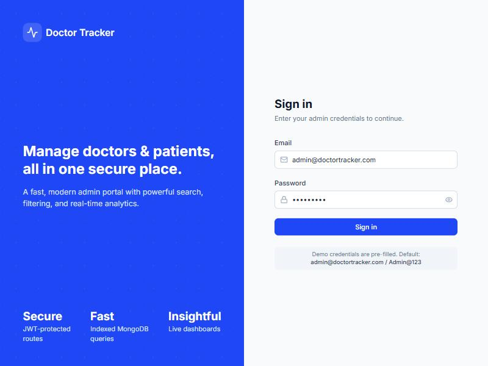
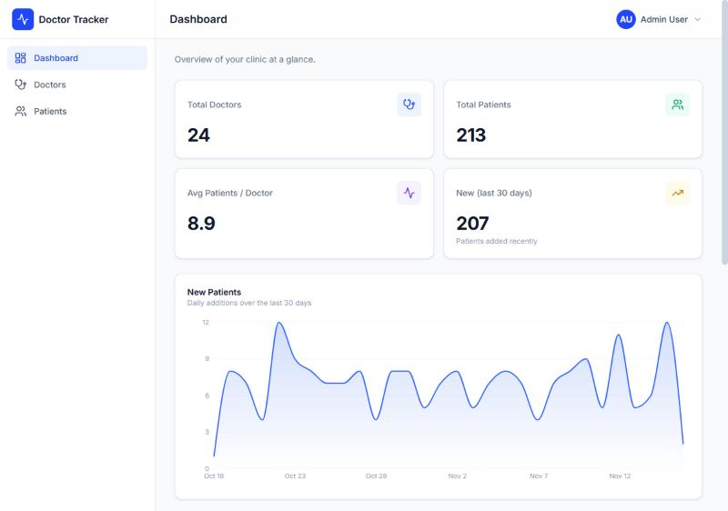
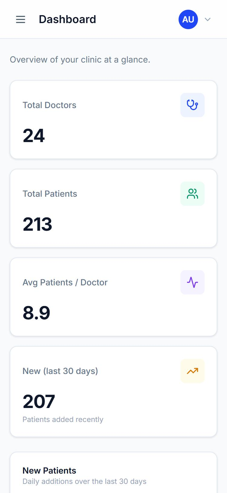
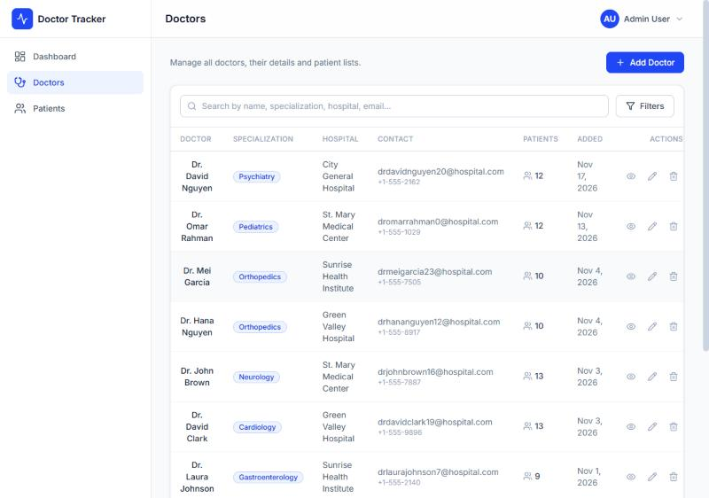
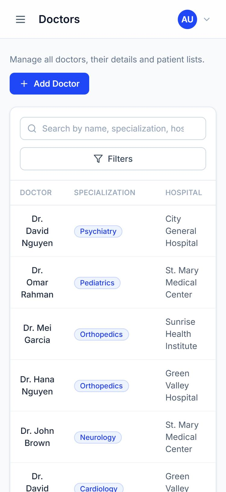
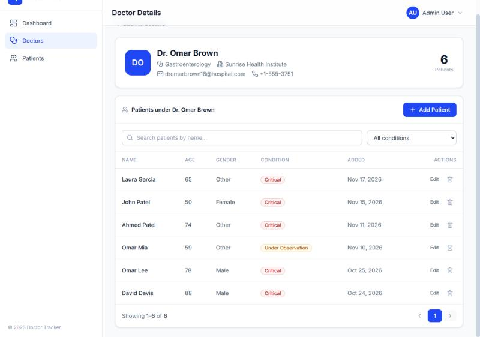
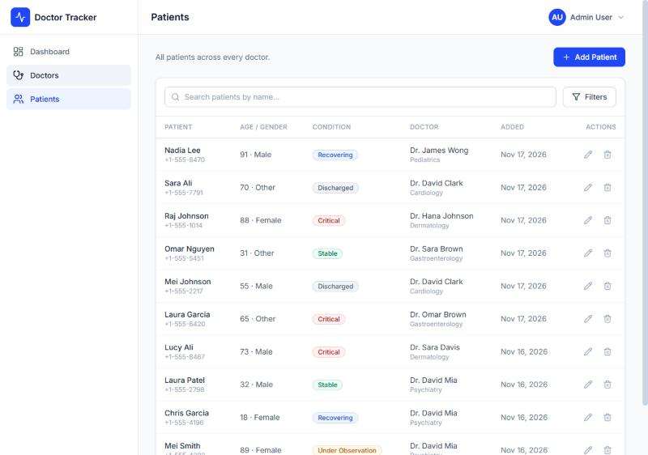
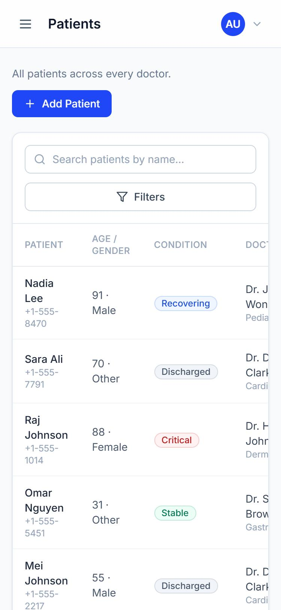

# Doctor Tracker

A secure admin portal for managing doctors and their patients, with search, filtering, pagination and an analytics dashboard. The front end is a Next.js app that talks to a separate Express REST API backed by MongoDB.

An administrator can create and manage doctors, keep each doctor's patient roster up to date, browse every patient from a single page, and see the clinic's overall numbers on a dashboard.

## Contents

1. [Features](#features)
2. [Tech stack](#tech-stack)
3. [System architecture](#system-architecture)
4. [Project structure](#project-structure)
5. [Getting started](#getting-started)
6. [Environment variables](#environment-variables)
7. [API reference](#api-reference)
8. [Technical decisions](#technical-decisions)
9. [Performance notes](#performance-notes)
10. [Screenshots](#screenshots)

## Features

- **Authentication** - JWT login, protected API routes, route guard in Next.js middleware, rate limiting on login.
- **Doctors** - create, edit, delete, search, filter by specialization and date range, pagination, and a patient count per doctor.
- **Patients per doctor** - open a doctor to see their roster, add patients under that doctor, remove them, search and filter by condition.
- **Patients (all)** - a dedicated page listing every patient with edit, delete, search, condition and date filters, and pagination.
- **Dashboard** - totals (doctors, patients, average patients per doctor, new in the last 30 days), a 30-day trend, patients per doctor, condition distribution, doctors by specialization, and the most recent patients.
- Responsive layout, toasts, loading skeletons, empty states, confirm dialogs and debounced search.

## Tech stack

**Frontend:** Next.js 14 (App Router), React 18, Tailwind CSS, SWR for data fetching, Recharts for charts, lucide-react icons.

**Backend:** Node.js, Express, Mongoose, JSON Web Tokens, bcryptjs, express-validator, helmet, cors, express-rate-limit, morgan.

**Database:** MongoDB. If no connection string is provided the server falls back to an in-memory MongoDB so the project runs without a local database install.

## System architecture

```
  Next.js (port 3000)                               Express API (port 5000)
  ┌─────────────────────┐    REST / JSON + JWT      ┌──────────────────────┐
  │ App Router pages     │  ──────────────────────▶  │ /api/auth            │
  │ Middleware guard     │                           │ /api/doctors   (auth)│
  │ SWR cache            │  ◀──────────────────────  │ /api/patients  (auth)│
  │ Recharts dashboard   │   { data, pagination }    │ /api/dashboard (auth)│
  └─────────────────────┘                            └──────────┬───────────┘
                                                                │ Mongoose
                                                                ▼
                                                     ┌──────────────────────┐
                                                     │ MongoDB               │
                                                     │ users / doctors /     │
                                                     │ patients (indexed)    │
                                                     └──────────────────────┘
```

How a request flows:

1. The browser posts credentials to `POST /api/auth/login`. The API checks the bcrypt hash and returns a JWT.
2. The token is kept in a `dt_token` cookie so the Next.js middleware can gate `/dashboard`, `/doctors` and `/patients` before the page renders, and the client also sends it as a `Bearer` header on each API call.
3. Protected Express routes run the `protect` middleware (verify token, load user) before reaching a controller.
4. Controllers query MongoDB through Mongoose with indexed filters, pagination and aggregation, and return a consistent `{ data, pagination }` shape.
5. The dashboard numbers come from one aggregated endpoint (`/api/dashboard/stats`).

## Project structure

```
backend/                     Express + MongoDB REST API
  src/
    config/db.js             Mongo connection (+ in-memory fallback)
    models/                  User, Doctor, Patient (with indexes)
    middleware/              auth, validate, errorHandler
    controllers/             auth, doctor, patient, dashboard
    routes/                  REST routers
    utils/                   asyncHandler, seed
    app.js                   Express app
    server.js                Entry point
  .env.example

frontend/                    Next.js App Router client
  app/
    (app)/                   Protected shell (sidebar + topbar)
      dashboard/
      doctors/               list + [id] detail
      patients/
    login/
    layout.js                Providers (auth, toast)
  components/                ui, layout, dashboard, doctors, patients
  lib/                       api client, auth context, constants, format
  middleware.js              Route guard
  .env.example
```

## Getting started

### Prerequisites

- Node.js 18+
- MongoDB (optional). Without it, the backend starts an in-memory MongoDB and seeds sample data, so you can run everything with no database setup.

### Backend

```bash
cd backend
cp .env.example .env        # Windows: copy .env.example .env
npm install
npm run dev                 # http://localhost:5000
```

On first start the API makes sure an admin user exists. If `MONGODB_URI` is not set it also seeds ~24 doctors and their patients so the UI isn't empty.

To use your own MongoDB, set `MONGODB_URI` in `.env`, then optionally seed sample data:

```bash
npm run seed                # add sample doctors + patients
npm run seed -- --reset     # wipe doctors/patients first, then seed
```

### Frontend

```bash
cd frontend
cp .env.example .env.local  # Windows: copy .env.example .env.local
npm install
npm run dev                 # http://localhost:3000
```

### Log in

Open http://localhost:3000 and sign in with the seeded admin (pre-filled on the form):

```
Email:    admin@doctortracker.com
Password: Admin@123
```

## Environment variables

### backend/.env

| Variable | Description | Default |
|----------|-------------|---------|
| `PORT` | API port | `5000` |
| `NODE_ENV` | `development` / `production` | `development` |
| `CLIENT_ORIGIN` | Allowed CORS origin(s), comma separated | `http://localhost:3000` |
| `MONGODB_URI` | Mongo connection string. Empty means in-memory DB | *(empty)* |
| `JWT_SECRET` | Secret used to sign tokens | `change_this...` |
| `JWT_EXPIRES_IN` | Token lifetime | `7d` |
| `SEED_ADMIN_NAME` / `SEED_ADMIN_EMAIL` / `SEED_ADMIN_PASSWORD` | Seeded admin account | see file |

### frontend/.env.local

| Variable | Description | Default |
|----------|-------------|---------|
| `NEXT_PUBLIC_API_URL` | Base URL of the Express API | `http://localhost:5000/api` |

## API reference

All routes are under `/api`. Everything except `/auth/login` and `/health` needs an `Authorization: Bearer <token>` header.

### Auth

| Method | Endpoint | Description |
|--------|----------|-------------|
| `POST` | `/auth/login` | Log in, returns `{ token, user }` |
| `GET`  | `/auth/me` | Current user (restore session) |

### Doctors

| Method | Endpoint | Description |
|--------|----------|-------------|
| `GET` | `/doctors` | List (`page, limit, search, specialization, startDate, endDate, sortBy, order`) |
| `GET` | `/doctors/specializations` | Distinct specializations for the filter dropdown |
| `POST` | `/doctors` | Create |
| `GET` | `/doctors/:id` | Get one (with patient count) |
| `PUT` | `/doctors/:id` | Update |
| `DELETE` | `/doctors/:id` | Delete (also removes the doctor's patients) |
| `GET` | `/doctors/:id/patients` | Doctor's patients (paginated, searchable) |
| `POST` | `/doctors/:id/patients` | Add a patient under a doctor |
| `DELETE` | `/doctors/:id/patients/:patientId` | Remove a patient from a doctor |

### Patients

| Method | Endpoint | Description |
|--------|----------|-------------|
| `GET` | `/patients` | List (`page, limit, search, condition, doctor, startDate, endDate, sortBy, order`) |
| `POST` | `/patients` | Create |
| `GET` | `/patients/:id` | Get one |
| `PUT` | `/patients/:id` | Update |
| `DELETE` | `/patients/:id` | Delete |

### Dashboard

| Method | Endpoint | Description |
|--------|----------|-------------|
| `GET` | `/dashboard/stats` | All dashboard numbers in one response |

## Technical decisions

### Separate Express API instead of Next.js route handlers

The brief asked for a standalone Node/Express server, and keeping the API separate from the Next.js app pays off in a few ways: the two can be deployed and scaled independently, the REST contract is easy to test and reuse from anything else, and all the security middleware (helmet, CORS, rate limiting, JWT checks) lives in one place guarding every data route. The cost is an extra process and CORS setup, which is handled with a small `.env` and an origin allow-list.

### SWR for data fetching instead of Redux

Almost all of the state here is server state - lists, details, dashboard numbers - not complex client state, so SWR fit better than Redux. It gives caching, request dedup and revalidation out of the box, refetches automatically after a mutation via `mutate()`, and `keepPreviousData` keeps the current table on screen while the next page or filter loads. The only real client state is the logged-in user, which a small React context handles. The token is stored in a cookie rather than only `localStorage` so the Next.js middleware can block protected routes before they render, on top of the API's own JWT checks.

## Performance notes

Database:

- Indexes on every field used for search, filter and sort: a text index on the doctor fields plus `specialization` and `createdAt`; on patients a compound `{ doctor, createdAt }` index plus `condition`, `createdAt` and a text index on the name.
- Patient counts for the doctor list come from a single `$lookup` + `$size` aggregation rather than a query per row, and the dashboard is one aggregation request.
- `countDocuments` and the page query run together with `Promise.all`.
- `.lean()` on read-only list queries, and `limit` is capped at 100.

Frontend:

- Debounced search (350 ms) so a request doesn't fire on every keystroke.
- SWR cache with `keepPreviousData` to avoid flashing between pages.
- Route guard in middleware so protected content never flashes before a redirect.
- Shared UI components keep the pages small and consistent.

## Screenshots

Screenshots are in [docs/screenshots](docs/screenshots).

| | Desktop | Mobile |
|---|---|---|
| Login |  | - |
| Dashboard |  |  |
| Doctors |  |  |
| Doctor detail |  | - |
| Patients |  |  |
